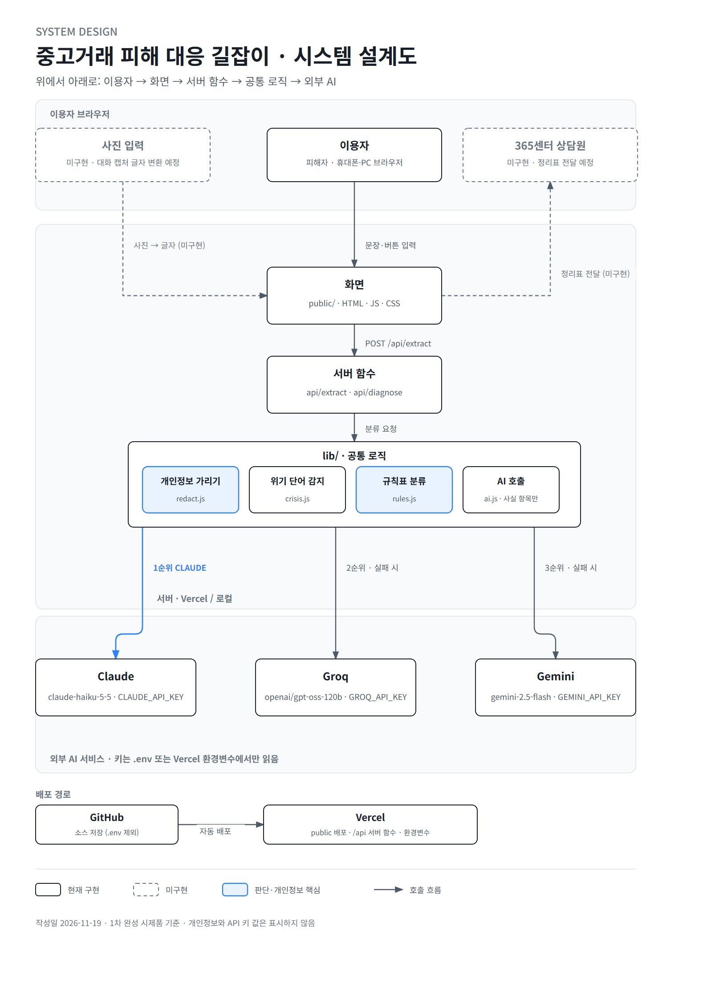

# 중고거래 피해 대응 길잡이

> 온라인피해 365센터 상담 전에, 중고거래 피해자가 **어디에 먼저 가야 하는지** 안내하는 진단·안내 도구의 시제품이다.
> 사기 여부나 자격을 판정하지 않는다.

- 만든 곳: 공공행정 프로젝트 1조
- 기준일: 2026년 11월 19일 (1차 완성 시제품)
- 문의처 안내: 온라인피해 365센터 ☎142-235, 평일 09:00~18:00[^1]

---

## Ⅰ. 개요

### 1. 하는 일
- 피해자가 쓴 문장이나 버튼 답을 **사실 항목**(상황, 송금 방법, 수령 상태, 연락 상태 등)으로 정리한다.
- 정리한 사실을 미리 정한 규칙표로 분류한다. 결과는 사기 의심 · 거래 분쟁 · 범위 밖(착오송금·보이스피싱) · 판단 어려움 넷 중 하나이다.
- 결과에 맞는 기관과 지금 할 일을 안내하고, 기관에 가져갈 증거 정리표를 만든다.

### 2. 하지 않는 일
- 사기 여부를 확정하지 않는다. 수사, 피해금 회수, 기관 자동 접수도 하지 않는다.
- 돈·비밀번호·인증번호를 묻지 않는다.
- 이용자가 쓴 글을 서버에 저장하지 않는다.

---

## Ⅱ. 주요 기능

〈표 1〉 주요 기능

| 기능 | 내용 | 상태 |
|---|---|---|
| 안전 확인 | 모든 입력에서 위기 표현을 단어 목록으로 감지해 자살예방 상담전화 109[^2]를 가장 먼저 안내한다 | 구현 |
| 상황 진단 | AI는 사실 항목의 값만 고르고, 분류는 규칙표(8줄)가 한다 | 구현 |
| 기관·할 일 안내 | 결과별 응급조치와 기관 순서를 안내한다. 거래 분쟁이면 판매자에게 보낼 요청 메시지 초안을 준다 | 구현 |
| 바로 연결·플랫폼별 안내 | 결과마다 전화(tel:)·누리집 버튼으로 기관에 바로 연결하고, 당근·번개장터·중고나라별 신고 방법과 돈 돌려받는 절차(법제처 생활법령정보·경찰청 근거)를 보여 준다. 이미 한 일(은행·경찰·앱 신고)은 다시 시키지 않는다 | 구현 |
| 증거 정리표 | 사건 경위(진술서 초안), 송금 내역, 신고 필수 항목 점검을 항상 같은 양식으로 만들어 내려받게 한다 | 구현 |
| 개인정보 가리기 | 전화번호·계좌번호·주민등록번호·이메일·주소를 가린 뒤에만 AI에 보낸다 | 구현 |
| 상담원 연결 | 정리표를 365센터 상담원에게 넘긴다 | 미구현 |
| 사진 입력 | 대화 캡처 사진에서 글자를 뽑아 정리한다 | 미구현 (팀 검토 중) |

---

## Ⅲ. 시스템 설계도

〈그림 1〉 시스템 설계도



- 원본 PDF: [docs/설계도/시스템설계도.pdf](docs/설계도/시스템설계도.pdf)
- 실선은 현재 구현된 부분, 점선은 아직 없는 기능이다. 파란 상자(개인정보 가리기, 규칙표 분류)가 이 서비스의 핵심이다.

### 1. 처리 흐름 (위에서 아래로)
- 가. 이용자가 화면(`public/`)에서 문장을 쓰거나 버튼을 고른다.
- 나. 서버 함수(`api/`)가 받아 공통 로직(`lib/`)으로 넘긴다.
- 다. 공통 로직은 위기 단어 감지 → 개인정보 가리기 → AI 사실 정리 → 규칙표 분류 순서로 처리한다.
- 라. AI는 Claude → Groq → Gemini 순서로 부른다. 앞이 실패하면 다음으로 넘어가고, 전체 대기 시간은 25초로 제한한다.
- 마. 결과와 증거 정리표가 화면에 나오고, 이용자가 정리표를 내려받아 직접 기관에 낸다.

### 2. 설계 원칙
- **판단은 AI가 아니라 규칙표가 한다.** 그래서 같은 상황이면 표현이 달라도 같은 결과가 나오고, 왜 그렇게 안내했는지(규칙 몇 번)를 설명할 수 있다.
- AI는 정해진 목록 안의 값만 고를 수 있다. 목록에 없는 값은 '모름'으로 바뀌고 버튼으로 다시 묻는다.
- API 키는 서버 환경변수에만 둔다. 화면 코드와 저장소에는 키가 없다.

---

## Ⅳ. 폴더 구성

〈표 2〉 폴더 구성

| 폴더·파일 | 내용 |
|---|---|
| `public/` | 이용자가 보는 화면(챗봇 형태) |
| `api/extract.js` | 문장 정리: 위기 단어 감지, 개인정보 가리기, AI 사실 정리 |
| `api/diagnose.js` | 진단: 규칙표 분류, 안내 문구, 증거 정리표 |
| `lib/rules.js` | 규칙표(기획서 〈표 7〉), 안내 문구, 정리표 양식 |
| `lib/crisis.js` | 위기 단어 목록 |
| `lib/intent.js` | 이용자 말의 종류(사건 설명·감사·감정·추가 질문)를 가르는 단어 목록 |
| `lib/redact.js` | 개인정보 가리기 규칙 |
| `lib/ai.js` | AI 호출(Claude → Groq → Gemini) |
| `docs/답변참고문서/` | 근거 문서(원본 · 청킹전 · 청킹 · 제외) |
| `docs/설계도/` | 시스템 설계도(HTML · PNG · PDF) |
| `server.js` | 내 컴퓨터에서 실행할 때 쓰는 서버 |
| `vercel.json` | Vercel 배포 설정 |

---

## Ⅴ. 실행 방법

### 1. 내 컴퓨터에서
- Node.js 20.6 이상이 필요하다.
- 프로젝트 폴더에 `.env` 파일을 만들고 아래 이름으로 키를 넣는다. 한 이름에 키를 쉼표로 여러 개 넣을 수 있다.
  - `CLAUDE_API_KEY`, `GROQ_API_KEY`, `GEMINI_API_KEY`
- 아래 명령으로 실행한 뒤 브라우저에서 `http://localhost:3000`을 연다.

```bash
npm start
```

### 2. 인터넷에 배포
- Vercel에 이 저장소를 연결하고, Environment Variables에 `.env`와 같은 이름으로 키를 넣는다.
- 자세한 순서는 [docs/배포가이드.md](docs/배포가이드.md)를 따른다.
- `.env`는 깃허브에 올리지 않는다(`.gitignore`에 들어 있다).

---

## Ⅵ. 검증 결과와 한계

### 1. 검증 결과
〈표 3〉 검증 결과 (2026년 11월 19일, 팀이 지어낸 문장으로 시험)

| 시험 | 결과 |
|---|---|
| 규칙표 단위 시험 | 20개 중 20개 통과 |
| 문장 100개 분류 (사기·분쟁·착오송금·보이스피싱·판단 어려움 × 20문장) | 맞음 70, 되묻기 28, 틀림 2. **사기를 분쟁으로 잘못 안내한 경우 0건** |
| 위기 표현 감지 | 위기 문장 20개 모두 감지, 위기 아닌 문장 100개 중 잘못 감지 0건 |
| 같은 문장 3번 반복 일관성 | 24문장 중 21문장이 같은 결과(87.5%) |

- '되묻기'는 정보가 부족해 버튼으로 다시 묻는 정상 동작이다.
- 틀린 2건은 분쟁 문장 1건이 사기 의심으로, 사기 문장 1건이 판단 어려움으로 간 경우이다. 둘 다 사기를 분쟁으로 안내하는 방향(기획서가 금지한 오류)은 아니다.
- 주의: 시험 문장과 정답은 개발 중 AI 보조로 만든 임시 자료이다. 기획서대로 팀원 2명이 정답을 따로 붙이는 검증은 아직 하지 않았다. 위기 단어 목록은 이 시험 문장 일부를 보고 보강했으므로, 위기 감지 결과는 새 문장으로 다시 확인해야 한다.

### 2. 한계
- 위기 단어 목록은 "짜증나서 못 살겠어요" 같은 일상 표현도 위기로 잡는다. 놓치는 것보다 낫다고 보고 이렇게 두었으며, 전문가 검토가 필요하다.
- 감사·감정·추가 질문을 가르는 단어 목록(`lib/intent.js`)은 아직 팀 검토를 받지 않았다. 애매한 말은 사건 설명으로 보는 쪽으로 두었다. 추가 질문에는 아직 답하지 않고 상담 창구(365센터·법률구조공단)만 연결한다.
- 개인정보 가리기는 이름과 닉네임을 가리지 않는다. 붙여 쓴 13자리 계좌번호는 '주민등록번호'로 표시된다(가려지기는 한다).
- 공개 배포 시 AI 호출 횟수에 제한이 없다. 사용료 보호 방법은 팀이 정해야 한다.
- 상담원 연결과 사진 입력은 아직 없다.

---

[^1]: 방송미디어통신위원회 누리집, 「온라인피해365센터 안내」, https://www.kmcc.go.kr/user.do?dc=K09031700&page=A09031700 (배포일 표기 없음. 팀 기획서 각주에서 재인용)
[^2]: 보건복지부, 「내년 1월부터 자살예방 상담전화 '109번'으로 통합 운영」, 대한민국 정책브리핑, 2023. 10. 23., https://www.korea.kr/news/policyNewsView.do?newsId=148921684
